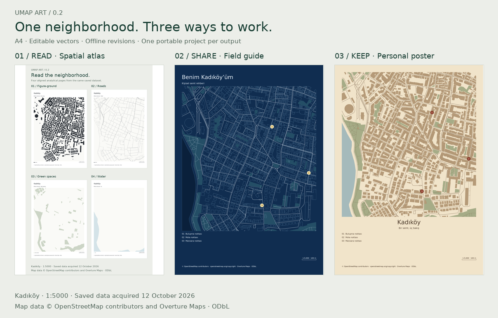

# Umap Art

**One neighborhood. An architectural atlas, a field guide and a poster you can keep editing.**

Create maps for spatial studies, presentations and personal neighborhood guides
from open data. Start with a bundled real-world example, then choose a theme,
add your own places, and export **PNG, editable SVG and vector PDF** at a
real-world scale — through Python, the CLI or a local MCP server.

[](pyproject.toml)
[](docs/release-notes.md)
[](LICENSE)

[Quick start](#quick-start) · [Python](#create-a-poster-in-python) ·
[MCP](#connect-your-mcp-client) · [Documentation](#documentation) ·
[Türkçe başlangıç](docs/hizli-baslangic.md)



*One saved Kadıköy dataset, acquired on 12 October 2026. All example pages are A4
at 1:5000; the atlas has a taller map frame than the poster and guide. Example
points are illustrative selections, not verified venues. Map data
© OpenStreetMap contributors and Overture Maps, ODbL.*

## What you can make

| Make | Start with | What you get |
|---|---|---|
| A personal city poster | `umap-art demo` | A4 portrait, vintage colours, a centred title and numbered places |
| A neighborhood guide | `umap-art demo --preset guide` | A4 portrait, blueprint colours and an ordered place directory |
| An architectural study | `umap-art demo --preset atlas` | Four aligned A4 pages for buildings, roads, green spaces and water |
| A general city map | [Kadıköy map](examples/kadikoy.json) | A3 landscape with a legend, scale bar and all four map layers |

- **Edit the artwork.** SVG retains semantic groups, individual paths, stable IDs
  and editable text. PDF embeds the bundled font.
- **Keep the scale.** Page geometry uses millimetres and points. Set a scale such
  as 1:5000, or fit a bounding box to the page.
- **Make it yours.** Choose from six themes, override layer colours, adjust title sizes
  and add up to twelve numbered places.
- **Revise offline.** Saved recipes pin a verified dataset. Changing colours,
  text or selected places reuses that data.
- **Take the project with you.** Every default export includes the recipe,
  snapshot, source manifest, font/license and a portable ZIP.

The bundled demo needs no map download. Acquiring your own area uses public
services without an account or API key. Their
availability and data coverage can vary. Umap runs locally and does not call a
model API; an MCP client supplies its own assistant.

## Quick start

Use Python **3.12–3.14**. These commands require the published **v0.2.0** package
on PyPI. See the [v0.2.0 release](https://github.com/U-C4N/Umap/releases/tag/v0.2.0)
and [release status](docs/validation.md) for publication and verification status.

```sh
python -m pip install "umap-art==0.2.0"
umap-art doctor
umap-art demo
```

If your shell cannot find `umap-art`, use `python -m umap_art` with the same Python
environment. The distribution name is `umap-art`; the import is `umap_art`.
For a source installation, see [Development and verification](#development-and-verification).

The demo works from the installed package, without cloning example files or
contacting map services. Its default is an A4 portrait poster in the vintage theme
at 1:5000. Installation itself may download Python dependencies.
The command prints the preview, SVG, PDF and recipe paths, and creates a new
project directory under `outputs`. Open a PNG to inspect the map or an SVG to
continue in your vector editor.

Make a guide, an architectural atlas or a different poster theme from the same
saved data, without editing JSON:

```sh
umap-art demo --preset guide --output outputs
umap-art demo --preset atlas --output outputs
umap-art demo --theme neon --output outputs
umap-art styles
```

Use `--preset poster`, `guide` or `atlas`; `--theme` overrides that preset's theme.
Each run keeps earlier outputs and delivers its own recipe, snapshot and ZIP.
The atlas produces four separate pages.
All three presets share a dataset and physical scale; their visible frames need
not match. The demo is an example of the saved data, not a current geographic survey.

For your own area, use the Python example below or adapt a [repository recipe](examples)
and run `umap-art render <recipe.json> --output outputs`. Those additional recipes
are not copied into your working directory by package installation. First
acquisition depends on public services; delivered snapshots support later offline edits.

## Choose your look

| Theme | Palette and treatment |
|---|---|
| `architectural` | Restrained greys and soft land/water colours |
| `city_poster` | Terracotta buildings, cream streets and blue water |
| `minimal` | Black, white and greys |
| `blueprint` | Navy background with pale vector outlines |
| `vintage` | Sepia, muted greens and warm paper colours |
| `neon` | Dark background, cyan roads and pink accents |

Use `page.layout="poster"` for a centred title below the map, or `"guide"` for a
title above it. Both provide a two-column directory for up to twelve places and
use the `general` view. The default `classic` layout also supports the four
analytical views.

The place band has a fixed size, even when empty: adding or removing a point does
not move the map frame. Neon uses vector fills and strokes, keeping the SVG and
PDF editable. See the [poster guide](docs/posters.md) for layout details.

## Create a poster in Python

```python
from umap_art import MapSpec, render

spec = MapSpec(
    area={"center": [29.025, 40.985], "scale_denominator": 5000},
    page={"size": "A4", "orientation": "portrait", "layout": "poster", "dpi": 300},
    style={"theme": "vintage", "accent": "#913E2B"},
    title="Kadıköy",
    subtitle="Seçtiğim noktalar · İstanbul",
    places=[
        {"id": "meeting", "label": "Buluşma noktası", "coordinates": [29.025, 40.985]},
    ],
)

result = render(spec, output_dir="outputs")
print(result.recipe_path)
```

Coordinates are always **longitude, latitude**. Place IDs must be unique;
numbering follows list order. Labels are your own content, and rendering does
not search for or invent locations.

To find coordinates by name:

```sh
umap-art locations "Kadıköy, İstanbul"
```

Choose the intended candidate and use its coordinates. Python and CLI recipes also
accept `area.place`; ambiguous results return candidates for you to choose from.

| To change… | Set… |
|---|---|
| Overall palette | `style.theme` |
| One layer's colour or line width | `style.layers` |
| Features matching a property, such as primary roads | `style.rules` |
| Text and marker colours | `style.ink`, `style.accent` |
| Title and subtitle size | `page.title_size_pt`, `page.subtitle_size_pt` |
| Place names, positions or order | `places` |

See the [recipe/API reference](docs/api.md) for field limits, filters and errors.
Version 0.2 reads existing v1 recipes with their classic defaults. Recipes using
the new poster fields require Umap 0.2 or newer, while `schema_version` remains `"1"`.

## Edit without downloading again

Continue from the Python example above, using its `result`:

```python
from pathlib import Path
from umap_art import MapSpec, render

recipe = Path(result.recipe_path)
edited = MapSpec.model_validate_json(recipe.read_text(encoding="utf-8"))
edited.source.snapshot = str(recipe.parent / edited.source.snapshot)
edited.style.theme = "blueprint"
edited.style.accent = "#FFE09A"
edited.places[0].label = "Burada buluşalım"

revised = render(edited, output_dir="outputs")
print(revised.recipe_path)
```

Saved recipes set `source.offline=true`. The CLI resolves a saved recipe's relative
snapshot path automatically; constructing a model from JSON yourself requires
resolving it as shown above.

Use `umap-art refresh` with your recipe when you explicitly want fresh data.
Changing providers or expanding the map beyond its pinned snapshot also requires
a refresh. Each render writes a new output directory and preserves earlier outputs.

### What travels with an export

A default single-view export contains:

```text
general.png          Raster image at the requested DPI
general.svg          Editable vector artwork
general.pdf          Vector PDF with embedded font
recipe.json          Design settings and selected places
snapshot.json        Hash-verified geographic data
manifest.json        Sources, versions, diagnostics and artifact hashes
assets/              Bundled font and its license
DATA-LICENSES.txt     Source attribution and license notices
project.zip          Portable copy of the project
```

Keep the whole output directory or `project.zip` to reproduce a design. Analytical
exports use their view names, such as `figure_ground.svg`, instead of `general`.
For SVG text editing, install the delivered DejaVu Sans font in your editor;
`page.text_mode="outline"` converts text to paths when font independence matters.

## Connect your MCP client

Install the optional MCP adapter, then start a local workspace:

```sh
python -m pip install "umap-art[mcp]==0.2.0"
umap-art mcp --workspace ./map-workspace
```

Register the command in your client's server configuration, with an absolute
workspace path and an executable the client can find. Example for Windows:

```json
{
  "mcpServers": {
    "umap": {
      "command": "umap-art",
      "args": ["mcp", "--workspace", "C:/maps/umap-workspace"]
    }
  }
}
```

Example request to your connected assistant:

> Create an A4 portrait poster of Kadıköy in the vintage theme. Use the title
> “Benim Kadıköy’üm” and mark the three coordinates I provide. Then change only
> the theme to blueprint and export SVG and PDF.

The server exposes **ten tools** for location search, styles, map creation,
inspection, edits, refresh, rendering, job status/cancellation and artifacts.
Long operations return a `job_id`; poll `get_job` for the result. Edits use
`base_revision`, and restoring an earlier version creates a new revision.

Colour, text and place edits use pinned data. For a larger page needing more
coverage, `refresh_map_data` accepts the intended `changes` and commits them only
after a successful refresh without a revision conflict.
See the [MCP contract](docs/mcp.md) for tool arguments, previews and artifact access.

## Data, scale and boundaries

| Data | Provider | How Umap uses it |
|---|---|---|
| Place search | [Photon](https://github.com/komoot/photon#demo-server) | Cached, user-initiated searches with explicit candidate selection |
| Buildings, roads, green and inland water | [OpenStreetMap / Overpass](https://dev.overpass-api.de/overpass-doc/en/preface/commons.html) | Bounded queries assembled with Pyosmium |
| Ocean polygons | [Overture](https://docs.overturemaps.org/schema/reference/base/water/) | Anonymous STAC/GeoParquet reads for the selected area |

- A3/A4 pages, portrait or landscape, fixed centre/scale or bbox fitting, up to
  **25 km²**. Choosing a place name does not select its entire administrative area.
- PNG at 72–600 DPI, editable SVG and RGB vector PDF. CMYK/PDF-X, routing, GPX,
  3D, a web editor and remote MCP are outside this release.
- Out-of-frame points and overflowing text produce explicit errors. Overlapping
  or edge-clipped markers produce diagnostics without moving their coordinates.
- Source dates can differ, and successful downloads do not establish geographic
  completeness. OSM building data is not a cadastral survey.

Umap owns its source adapters, geometry pipeline, declarative styles and scene
model. Shapely, pyproj and Matplotlib provide infrastructure; Prettymaps, OSMnx,
QGIS and GDAL are not runtime dependencies. Python calls within one process are
serialized; MCP uses isolated render workers. See the [architecture](docs/architecture.md).

## Development and verification

To install the source checkout, including the optional MCP adapter:

```sh
git clone https://github.com/U-C4N/Umap.git
cd Umap
python -m pip install ".[mcp]"
umap-art demo
```

Use `python -m pip install .` if you only need the core package. The checkout also
contains the additional [example recipes](examples) and the showcase scripts.
For development checks, install [uv](https://docs.astral.sh/uv/), then run from
the repository:

```sh
uv sync --frozen --all-extras --dev
uv run pytest -m "not live"
uv run ruff check src tests scripts
uv run python scripts/benchmark.py
uv run python scripts/poster_gallery.py
uv run python scripts/release_showcase.py --output outputs/release-showcase
```

The benchmark and default gallery generator use synthetic snapshots. The release
showcase uses the bundled real Kadıköy snapshot, creates the six themes, a guide,
four analytical pages and a before/after comparison, and verifies an extracted
ZIP can reproduce the edited result. All three disable network connections.
Choose a new showcase output directory on every run to preserve its evidence.
Its `index.json` records dataset, geometry, marker, scene and artifact checks;
this does not replace manual SVG editing acceptance. To test public providers:

```sh
uv run pytest --live -m live
```

**Recorded v0.2 validation, 13 October 2026:** 133 tests passed on Windows x64 /
Python 3.14.6, Ruff passed, and a fresh wheel installation passed offline output
and real MCP stdio checks. Four classic reference images remained pixel-identical.
The repository configures a nine-environment CI matrix; remote results for these
changes, Inkscape GUI acceptance, the user pilot and reference-machine performance
remain separate release gates. See [validation and measured performance](docs/validation.md).

For bug reports, include the output of `umap-art --version`, the error code and a
minimal recipe. [Open an issue](https://github.com/U-C4N/Umap/issues).

## Documentation

| I want to… | Read |
|---|---|
| Get started in Turkish | [Türkçe hızlı başlangıç](docs/hizli-baslangic.md) |
| Design a poster or guide | [Poster workflow and gallery](docs/posters.md) |
| Understand recipe fields and errors | [Python/API reference](docs/api.md) |
| Connect an assistant | [Local MCP workflow](docs/mcp.md) |
| Understand the implementation | [Architecture and data ownership](docs/architecture.md) |
| Check what changed and what was verified | [Release notes](docs/release-notes.md) · [Validation](docs/validation.md) |
| Publish a release | [GitHub/PyPI publishing guide](docs/publishing.md) |

## License and attribution

Umap's application code is [MIT licensed](LICENSE). Geographic data retains its
source licenses: OpenStreetMap and Overture Base water use ODbL. DejaVu Sans has
its [own bundled license](src/umap_art/assets/fonts/LICENSE_DEJAVU).
Preserve the source attribution when sharing artwork; source and font notices
travel with each default export.

[OpenStreetMap attribution](https://www.openstreetmap.org/copyright) ·
[Overture attribution](https://docs.overturemaps.org/attribution/)
