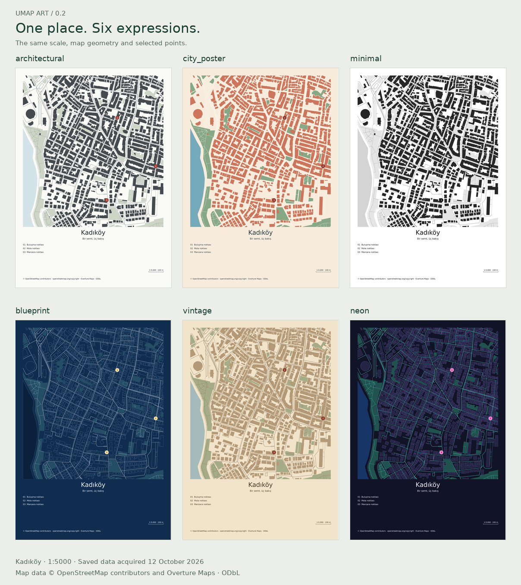
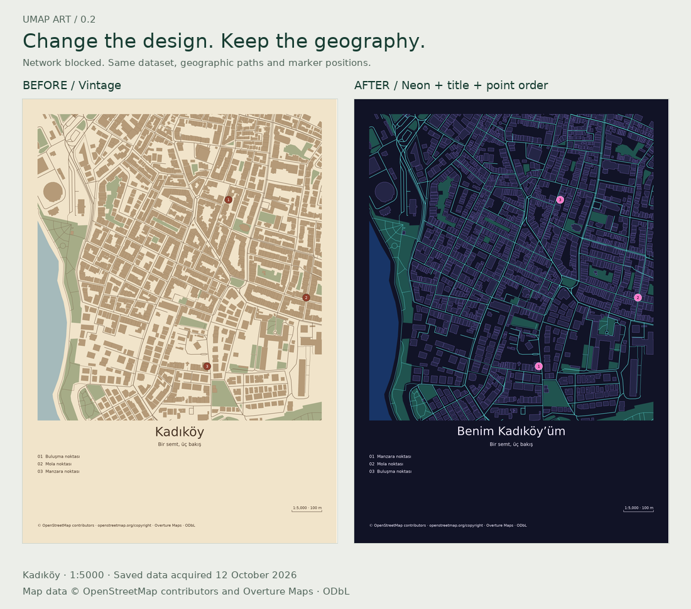

# Make a personal map poster

Requires Umap Art 0.2. Existing recipes retain their classic defaults; the new
poster fields are not readable by 0.1. All coordinates are longitude, latitude.

## Choose a look

Start from the installed example without writing a recipe:

```sh
umap-art demo
umap-art demo --preset guide
umap-art demo --theme neon
```

The bundled poster and guide use the same three example points and saved Kadıköy
data. Both are A4 portrait at 1:5000. `umap-art demo --preset atlas` uses the same
dataset for four aligned architectural pages with a taller map frame. Initial
package installation may use the network; demo rendering does not request map data.



The gallery uses the same selected coordinates and the bundled Kadıköy snapshot,
acquired on 12 October 2026. Map data © OpenStreetMap contributors and Overture
Maps, ODbL. See [OpenStreetMap attribution](https://www.openstreetmap.org/copyright)
and [Overture attribution](https://docs.overturemaps.org/attribution/).
The example points illustrate user selections; they are not verified venue listings.

| Theme | Appearance | Useful starting point |
|---|---|---|
| `architectural` | Restrained grey | Spatial studies |
| `city_poster` | Terracotta and blue | Warm city prints |
| `minimal` | Black, white and greys | Monochrome posters |
| `blueprint` | Navy, pale outlines | Linework and numbered guides |
| `vintage` | Sepia, muted greens | Warm paper colours |
| `neon` | Dark background, cyan and pink | High-contrast digital artwork |

Neon uses ordinary vector fills and strokes, so SVG and PDF stay editable. It
does not use raster glow effects. Colours are RGB, not a CMYK/PDF-X print profile.

## Render and revise

From the repository checkout:

```sh
umap-art render examples/kadikoy-poster.json --output outputs
umap-art render examples/kadikoy-guide.json --output outputs
```

The first example uses A3 portrait and vintage colours; the second uses A4 portrait
and blueprint colours. Both produce PNG, SVG, PDF and a portable ZIP. Use the saved
`recipe.json` for subsequent offline edits, keeping its adjacent snapshot.
These repository recipes are separate from the A4 presets included in `demo`.

- `poster` centres the title below the map; `guide` places it above, aligned left.
- `places` stores at most twelve selected points. IDs remain stable; numbering
  follows order. Names appear in a two-column list, six rows per column.
- `style.ink` and `style.accent` override text and marker colours. Layer paints
  and filters continue to work. Font sizes use physical points.
- The directory always reserves 36 mm, including an empty list. Editing places
  cannot move the map frame or require fresh map data.

Use `umap-art locations` to obtain candidate coordinates, then explicitly choose
the intended result. No location search occurs during place rendering. The same
recipe works in Python and MCP; see the [API](api.md) and [MCP workflow](mcp.md).

## Fix an output that does not fit

Long titles or names return `TEXT_OVERFLOW`; unsupported characters return
`MISSING_GLYPH`. Shorten the text or adjust title/subtitle size. Text is never
silently truncated. Labels use the bundled DejaVu Sans font.

`PLACE_OUTSIDE_MAP` means the selected coordinate is outside the projected frame.
Remove/change the point or explicitly acquire a wider map. Overlapping or clipped
markers are warnings, not automatic coordinate changes. A wider page can require
`refresh` (CLI) or `refresh_map_data(changes=...)` (MCP).

Keep the source attribution when sharing. For independent text editing in an SVG
editor, install the delivered font. `page.text_mode="outline"` converts text to
paths if you prefer font-independent appearance.

## Reproduce a gallery without networking

For the complete real-data release example, run from the repository with the
development dependencies installed:

```sh
uv run python scripts/release_showcase.py --output outputs/release-showcase
```

Use a new output directory each time. The script renders all six themes, a guide
and four analytical pages. Then it changes the poster's theme, title and point
order with networking blocked, extracts that result's portable ZIP and renders
the saved recipe from its new location. `index.json` records the actual checks:
unchanged dataset, extent, scale, map paths and marker positions; updated title
and numbering; matching scenes and outputs on this runtime after ZIP extraction.
It also records artifact hashes and relative paths to every project.



This verifies output structure and reproducibility. It does not claim that a
human edited the SVG in Inkscape, that data coverage is complete, or that files
from different operating systems have identical bytes. The atlas and poster
share source data but have different map-frame heights.

For the original synthetic gallery:

```sh
uv run python scripts/poster_gallery.py
```

This creates six theme outputs, a guide output and a contact sheet under
`outputs/poster-gallery/`, using labelled synthetic geometry and blocked network
connections. It needs the development dependencies, including Pillow.

To generate the real-city gallery, first produce the existing
`examples/kadikoy.json` map and pass its delivered snapshot path through
`--snapshot`. That snapshot must cover A4 portrait at the same centre and 1:5000.
Use `--output` for a different result directory and `--gallery` for a contact-sheet
filename. All outputs include their own recipes, snapshots and manifests.
